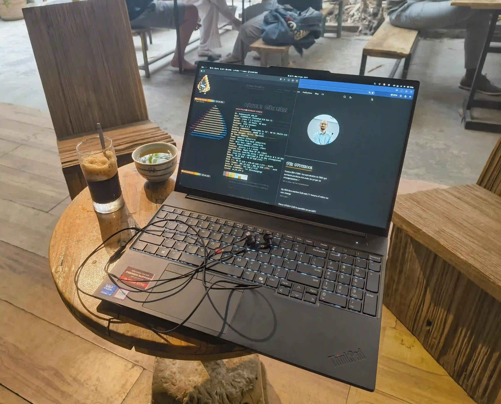
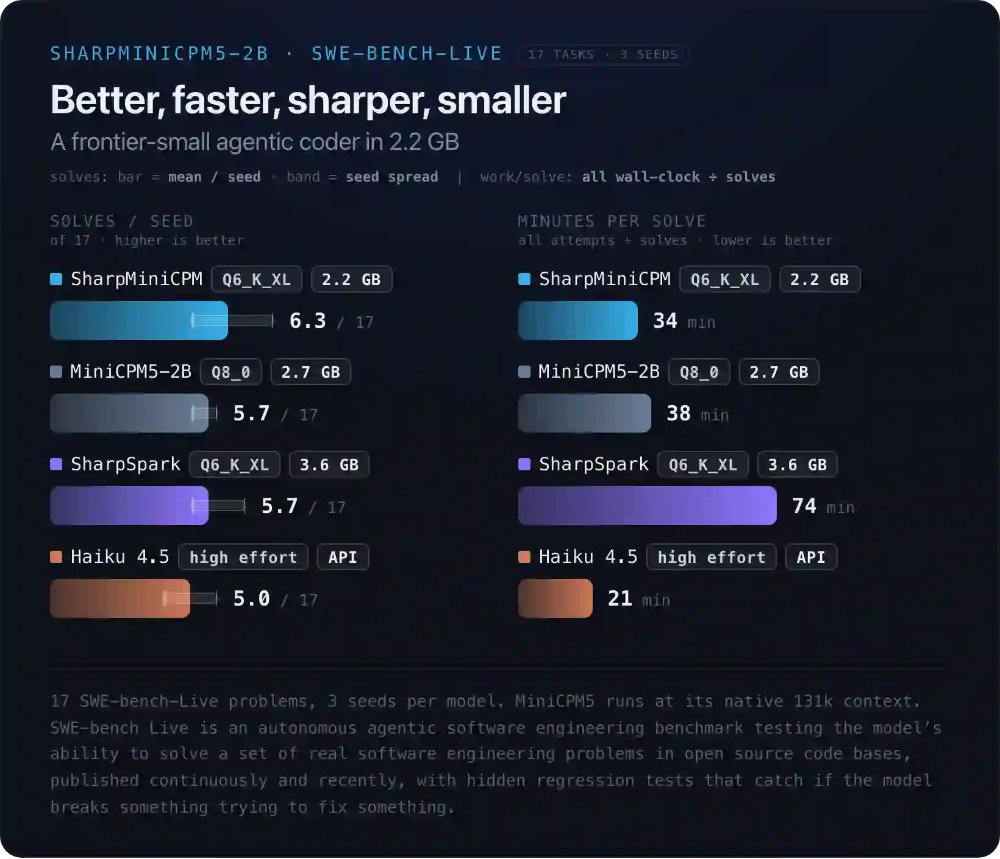

I wanted a small local model to drive a coding agent on my laptop. No server, no cloud, just the integrated GPU (iGPU) of my ThinkPad. On a short prompt, with proper tuning, a small model decodes at about *20 tokens per second*, which is perfectly fine. The trouble starts when the context fills up, and a coding agent fills it up fast.

This post is for anyone running llama.cpp on an Intel iGPU who wonders which knobs actually matter once the context grows. Three things came out of a few weeks of poking at it: the kernel driver matters (nearly doubles the speed), the model that wins on a short prompt (MoE) is not the one that wins at 13k tokens (dense), and speculative decoding goes from 1.7x faster on an empty context to 2x *slower* at 28k tokens.

> [!TIP]
> A few terms I use everywhere below:
> - *Prefill* (`pp` in llama-bench): reading the prompt. Measured in tokens per second (*t/s*).
>   - The time to wait before the model starts to write text (thinking or *speaking*).
> - *Decode* (`tg`, for "text generation"): writing the answer, one token at a time.
>   - The generally said "model speed".
> - *Depth*: how many tokens already sit in the context. `tg256 @ d8192` means "generate 256 tokens with 8192 tokens already in context".
>
> I covered prefill and decode in more detail in my [llama-server post](https://arthurbrugiere.fr/blog/2026/08/llama-server-lfm-parallel/), on a much older Iris Xe.

## Why a small model, and why on the laptop

The agent harness I've been testing for this post[^1] is [Swival](https://swival.dev), a coding agent built for small local models with small contexts (around 32k tokens). It compacts the conversation, keeps notes on disk and retrieves them when needed, so it doesn't need a huge model to be useful. I don't expect a small model to replace a frontier one (I still heavily use [Claude Code](https://code.claude.com/)). I want to know how far it gets on a laptop, to eventually use a frontier model to coordinate small local workers, and for that it first needs to be fast enough to not drive me crazy. And it must leave me a usable machine (i.e. not eating all the resources, spinning the fans like a plane or lagging the display), since I keep working on the same machine while it runs.

## The rig

| Component | Component name |
|---|---|
| Laptop | [ThinkPad E16 Gen 3](https://www.lenovo.com/vn/vi/p/laptops/thinkpad/thinkpade/lenovo-thinkpad-e16-gen-3-16-inch-intel/len101t0120) |
| CPU | Intel Core Ultra 7 255H (Arrow Lake-H) |
| GPU | Intel Arc 140T (integrated, 128 compute units) |
| NPU | Exists (not used by llama.cpp) |
| RAM | 48 GiB DDR5 (5200 MT/s) |
| OS | EndeavourOS, GNOME (Wayland). Kernel 7.2 |

<figure>
    
    <figcaption>My ThinkPad laptop at a coffee shop 🇻🇳</figcaption>
</figure>

### SYCL, Vulkan, OpenVINO: pick the right llama.cpp backend

Before running models with llama.cpp, the main model inference engine, we need to pick the backend we want to use. Several options exist:

- *CPU*: Can give better performance than the iGPU on some older systems, but my laptop has a fairly new chip and I want to run the model on the iGPU. 
- [*Vulkan*](https://en.wikipedia.org/wiki/Vulkan) is the simplest way to run models on the GPU, processing the inference through the graphics API.
- [*SYCL*](https://en.wikipedia.org/wiki/SYCL) is Intel's way to run general compute code on its GPUs, and llama.cpp has a backend for it. 
- [*OpenVINO*](https://en.wikipedia.org/wiki/OpenVINO) is Intel's newer (and still experimental) way to run LLM compute on its ecosystem (CPU, GPU, NPU), and llama.cpp also has a backend for it.


Similarly [to before](https://arthurbrugiere.fr/blog/2026/08/ollama-intel-igpu/), I chose to run everything on SYCL on my Intel machine. Why not the other backends? I tried Vulkan several times, and every time the model and the desktop fought over the GPU through the same graphics API. The laptop became really unpleasant to use, and I need to keep working while the agent runs. And OpenVINO has been a bit of a fight that led nowhere, which I'm detailing [here if you're interested](https://arthurbrugiere.fr/blog/2026/11/openvino-arc-igpu-llama-cpp/).

So SYCL it is.

Every llama-bench run below (llama.cpp's built-in benchmarking tool) uses the same flags: `-ngl 99 -fa on -t 6 -b 1024 -ub 256` (the most important option here is `-ngl 99`, which pushes the full model onto the GPU, so no offloading), three repetitions each, laptop on AC.

### i915 or xe: pick the right driver first

Linux has two kernel drivers for Intel GPUs: the old [`i915`](https://docs.kernel.org/gpu/i915.html) and the newer [`xe`](https://docs.kernel.org/gpu/xe/index.html), written for recent Intel graphics. On Arrow Lake (or maybe on most distros, whatever the hardware?), `i915` is still the default. `xe` is opt-in, with kernel parameters. On EndeavourOS with GRUB:

```bash
# /etc/default/grub, appended to GRUB_CMDLINE_LINUX_DEFAULT
i915.force_probe=!* xe.force_probe=*

$ sudo grub-mkconfig -o /boot/grub/grub.cfg
$ sudo sbctl sign-all    # I use Secure Boot with sbctl
```

After a reboot, `inxi -G` should say `driver: xe` instead of `driver: i915`.

```bash
$ inxi -G
Graphics:
  Device-1: Intel Arrow Lake-P [Arc Pro 130T/140T] driver: xe v: kernel <== HERE
  Device-2: Chicony Integrated Camera driver: uvcvideo type: USB
  Display: wayland server: Xwayland v: 24.1.14 compositor: gnome-shell
    v: 51.1 driver: gpu: xe resolution: 1920x1200~60Hz
  API: EGL v: 1.5 drivers: iris,swrast
    platforms: gbm,wayland,x11,surfaceless,device
  API: OpenGL v: 4.6 vendor: intel mesa v: 26.2.6-arch1.1 renderer: Mesa
    Intel Graphics (ARL)
  Info: Tools: api: clinfo, eglinfo, glxinfo gpu: gputop, intel_gpu_top,
    lsgpu x11: xprop,xrandr
```

I had already tried `xe` in August and got *worse* results, so I didn't expect much. Same llama-server command, newer llama.cpp build, same model (Ling-3.0-tiny, more on it below), same first request of an agent session:

| | i915 | xe |
|---|---|---|
| Prefill, same 308-token request | 66.9 t/s | 98.8 t/s |
| Decode, longer replies | 10.9 t/s (358 tokens)<br>11.6 t/s (382 tokens) | 19.9 t/s (98 tokens)<br>17.9 t/s (1,993 tokens) |

That's about *+50% on prefill* and **+55 to +80% on decode**. Not a small tweak. These numbers come from llama-server's own logs on real agent requests, not from a clean llama-bench run, so the replies don't have the same length on both sides. The gap is big enough that I'm not worried about the noise.

> [!NOTE]
> For some reason, on the same setup llama.cpp reported much more GPU memory available under `xe` (~35 GiB against ~23.5 GiB under `i915`). 
> 
> It didn't matter for these small models, so I didn't dig further into it.

All the numbers in the rest of this post are on `xe`.

## Dense, MoE, hybrid: the short prompt lies

### Two small models

- [Ling-3.0-tiny](https://huggingface.co/inclusionAI/Ling-3.0-tiny-GGUF): a [*Mixture of Experts*](https://en.wikipedia.org/wiki/Mixture_of_experts) (*MoE*). It has 7.89B parameters split into 128 "experts", and a router picks 8 of them per token, so only a fraction of the weights work for each token (about 1.3B). It's also a *hybrid*: only 6 of its 24 layers use classic attention, the others keep a compact recurrent state. 4.49 GiB at Q4_K_M.
- [MiniCPM5-2B](https://huggingface.co/openbmb/MiniCPM5-2B-GGUF): a *dense* model. Every parameter is used for every token, and all 42 layers use attention. 1.45 GiB at Q4_K_M.

So, even though they are not the same model size (Ling 3.0 is ~8B parameters and MiniCPM is ~2B), they have the same amount of *active* parameters (~2B) at the same quantization, which makes them comparable (for the inference[^2]).

### On short prompts, the MoE wins

I started with Ling-3.0-tiny, and it looked great. On short agent requests (a few hundred tokens of context), it decoded at 19 to 20 t/s. MiniCPM5 only did about 17.5 t/s on the same kind of request.

As expected, a MoE is a bigger model, but it's fast because it doesn't compute each token over the full model (as a dense one does), and the numbers match that (the ~3 t/s difference probably comes from Ling's 1.3B active parameters against MiniCPM's 2.5B). So I plugged Ling into my agent harness, with a 32k context, and let it work on a small web project.

### In a real session, it doesn't

llama-server reported about *10.5 t/s* on average over 88k generated tokens. One request with 13,182 tokens of context decoded at about 8.8 t/s. Half the speed of the short prompts.

And the desktop lagged. Not a crash, just a constant stutter in GNOME while the agent worked. `gputop` showed llama-server holding two GPU engines nearly full:

```txt
DRM minor 128   Frequency(MHz) GT0-800/350 GT1-100/450
PID    MEM RSS   rcs     vcs     vecs       bcs              ccs          NAME
264044  4G  4G | 0.0% || 0.0% || 0.0% || 98.8% ████████|| 97.9% ███████▉| llama-server
[...]
```

The last two columns are `bcs` and `ccs`. `ccs` is the *compute* engine, where the model runs. `bcs` is the *copy* engine, which moves data around. On an iGPU, the desktop and the model share the same RAM and the same GPU access, so the compositor has to fight for its turn. Smaller batches (`-ub 256 -b 1024`) and a 16k context brought `bcs` down to 85-90% and `ccs` to 95-98%. It felt a bit better, not good.

### llama-bench tells the same story

To get clean numbers, I ran both models (both at Q4_K_M) through llama-bench, on an empty context and at 12k tokens:

| | d0 | d12288 | Drop |
|---|---|---|---|
| Ling-3.0-tiny prefill | 216 t/s | 33 t/s | -85% |
| Ling-3.0-tiny decode | 22.9 t/s | 9.4 t/s | -59% |
| MiniCPM5 prefill | 770 t/s | 422 t/s | -45% |
| MiniCPM5 decode | 23.7 t/s | 16.6 t/s | -30% |

On an empty context, they tie on decode. At 12k, the dense model is almost twice as fast. And look at Ling's prefill: weaker even at depth 0 (216 t/s against 770), and it collapses to 33 t/s with context. By my rough estimate, a 12k-token prompt takes around 25 seconds to read on MiniCPM5, and a few minutes on Ling. A coding agent re-reads (roughly) a growing context on every turn, so this number matters.

Why such a difference? My (limited) understanding is that it's related to how much data the iGPU has to move around. The dense model is small (1.45 GiB) and reads the same weights, in the same order, for every token. Ling's file is three times bigger, and its router picks a different set of experts for each token, so the GPU keeps fetching scattered chunks of weights from the shared RAM. That matches the copy engine sitting at 98% (I haven't profiled it, so take it as an educated guess). What I measured is simpler: on this iGPU, the dense model holds up much better as the context grows.

This got confirmed a few tests later. [LFM2.5-24B-A2B](https://huggingface.co/LiquidAI/LFM2.5-24B-A2B-GGUF), from Liquid AI ([my favorite](https://arthurbrugiere.fr/blog/2026/08/llama-server-lfm-parallel/) LLM family), is a much bigger MoE: 24B parameters, of which only about 2B work for each token. On paper, that's as cheap per token as MiniCPM5. In practice, the Q4 file weighs 14.5 GB, about nine times the MiniCPM5 Q4_K_M file. On my laptop, it decoded a ~210-token reply at *3.7 t/s* with Unsloth's UD-Q4_K_XL quant, and *2.3 t/s* with Liquid's own Q4_K_M. That's six to ten times slower than MiniCPM5 at Q4. 

Meaning, on an iGPU, "active parameters" doesn't really matter for speed, but how much the GPU has to move around does[^3].

With MiniCPM5, the desktop also stopped stuttering in a way I noticed (again, probably thanks to less data moving to the GPU). I didn't measure that one, it's what I felt while typing in another window. So I switched.

> [!NOTE]
> More exactly, for the next part, I'm running [peculiar-ragdoll](https://huggingface.co/peculiar-ragdoll)'s fine-tune [Sharp-MiniCPM5](https://huggingface.co/peculiar-ragdoll/Sharp-MiniCPM5-2B-GGUF) at Q6_K_XL (2.2 GB).
> 
> <figure>
>     
>     <figcaption>Benchmark of Sharp-MiniCPM5.<br/>Can we take a second to see that 2B models are beating Haiku 4.5 now? 🤯</figcaption>
> </figure>

### Plot twist: it's the attention layers

While I was finishing this post, Liquid AI (again) released [LFM3](https://www.liquid.ai/blog/lfm3), a family of small models built on a 1.7B backbone. I ran the text model, [LFM3-1.7B](https://huggingface.co/LiquidAI/LFM3-1.7B-GGUF) at Q6_K, through the same llama-bench sweep, and put it next to my Sharp-MiniCPM5 Q6 (from the re-run at the end of this post):

| | d0 | d8192 | d16384 | d32768 | Loss 0 to 32k |
|---|---|---|---|---|---|
| LFM3-1.7B decode | 38.6 t/s | 35.0 t/s | 32.7 t/s | 29.5 t/s | **-24%** |
| Sharp-MiniCPM5 decode | 27.4 t/s | 20.4 t/s | 18.1 t/s | 15.4 t/s | -44% |
| LFM3-1.7B prefill | 1,089 t/s | 931 t/s | 845 t/s | 705 t/s | **-35%** |
| Sharp-MiniCPM5 prefill | 800 t/s | 503 t/s | 410 t/s | 241 t/s | -70% |

Two small caveats first. LFM3 ran on a newer llama.cpp build (11972), with a few new SYCL options, so this isn't a strict like-for-like. And LFM3 is smaller (1.73B parameters against 2.52B), so being faster on an empty context is no surprise. The interesting column is the last one: LFM3 loses about half as much as MiniCPM5 when the context fills up. At 32k, that's twice the decode and three times the prefill.

The reason is in its architecture. According to Liquid, LFM3-1.7B has 24 layers: 13 short convolutions, 5 *sliding-window* attention layers that only look at the last 256 tokens, and **only 6 *global* attention layers** that look at the whole context. Only those 6 get slower as the context grows. MiniCPM5 has 42 layers, and all of them are global attention.

It also clears Ling a little. Ling also has only 6 attention layers out of 24, but it still collapsed. So its hybrid design isn't what hurt it: LFM3 is a hybrid without MoE, and it holds up fine. That leaves the MoE side as the main suspect (moving a lot of data to the GPU), also matching what LFM2.5 showed above.

I haven't tried LFM3 in Swival yet, and Liquid itself says bigger models still win at agentic coding. A model that's twice as fast but breaks its tool calls won't help my agent. But it's the next thing I'll try.

> [!TIP]
> Two takeaways here if you're on an Intel iGPU:
> - Don't pick a model by its decode speed on a short prompt. Run llama-bench with `-d 0,8192` (or deeper) and look at how much it loses.
> - To estimate the speed, check how many layers use global attention: the fewer, the better it should hold up.

## Picking the quant

Same(-ish) model, three quantizations, same flags:

| | Size | tg d0 | tg @ d8192 | pp d0 | pp @ d8192 |
|---|---|---|---|---|---|
| Q4_K_M | 1.45 GiB | ~23.4 | ~17.5 | 697-770 | ~495 |
| [Sharp Q6_K_XL](https://huggingface.co/peculiar-ragdoll/Sharp-MiniCPM5-2B-GGUF) | 2.04 GiB | 19.8 | 15.8 | 676 | 472 |
| Q8_0 | 2.49 GiB | 17.9 | 13.6 | 603 | 418 |

Q8_0 is 72% bigger than Q4_K_M but only 23% slower. If decode were purely limited by memory bandwidth, the slowdown would follow the size. It doesn't, which tells me a large part of each token is a fixed cost. 

My quick maths: about 43 ms per token at Q4, 56 ms at Q8, so the extra 1.04 GiB costs about 13 ms. Working backwards, roughly 25 ms of every token doesn't depend on the weights at all (FOR THIS MODEL!). That's two data points and a big assumption (that both kernels are equally efficient), so don't quote me in a paper. It's also why I tried llama.cpp's experimental SYCL graph mode, which should cut that kind of overhead. It changed nothing on Ling and crashed MiniCPM5[^graph].

The practical consequence is nice though: a bigger quant costs less than I thought. A 2B model suffers a lot from heavy quantization, and for an agent that shows up as broken tool calls. So I went for the middle option: *Sharp-MiniCPM5-2B Q6_K_XL*, a third-party quant whose author claims it does at least as well as the stock Q8_0 on SWE-bench-Live.

## Speculative decoding: great on an empty context

[*Speculative decoding*](https://arxiv.org/abs/2211.17192) means guessing the next few tokens cheaply, then letting the real model check all of them in a single pass. Every correct guess is a token you got almost for free. Every wrong guess is wasted work.

There are a lot of algorithms to do it, and I honestly don't understand much there, so I relied on Claude to guide me, and it made me try two ways to guess.

### N-gram drafts: no gain

llama-server's `--spec-default` guesses from text already in the context (*n-gram* drafts), with no extra model. It's tempting for an agent, which repeats a lot of code.

On Ling, the logs showed 64-token drafts with only 15.6% accepted (10 out of 64, wrong by the 11th token). Capping the drafts to 2-8 tokens (`--spec-ngram-mod-n-min 2 --spec-ngram-mod-n-max 8`) gave no real gain. On Sharp-MiniCPM5, it was worse: decode dropped from about 15.5 to 13.9 t/s. I turned it off.

### DSpark: a real draft model

openbmb ships a small *draft* model made for MiniCPM5: [MiniCPM5-2B-DSpark](https://huggingface.co/openbmb/MiniCPM5-2B-DSpark-GGUF) (a 653 MB BF16 file). The idea is to run a super cheap (small) model to draft guesses, and let the bigger model (MiniCPM5) check/validate them. The model card's recipe for llama-server:

```bash
llama-server -m Sharp-MiniCPM5-2B-Q6_K_XL.gguf \
  -md MiniCPM5-2.6B-DSpark.gguf \
  --spec-type draft-dspark --spec-draft-n-max 7 \
  -ngl 99 -ngld 99
```

`--spec-draft-n-max` is how many tokens the draft guesses per round.

Given the fixed cost I found above, I had good hopes. If most of a decode step is overhead, checking 4 tokens should cost barely more than checking 1.

#### How I measured it

llama-bench can't drive a draft model reliably, so I wrote a small Python script. It starts one llama-server per configuration (no draft, `n=3`, `n=7`), fills the context to a given depth with real Java code from one of my projects, sends three prompts, and reads the server's own timings. Two runs per prompt, 256 tokens each. The three prompts:

- *code*: write a small class from scratch;
- *code-edit*: rewrite an existing piece of code with a small change. This is the closest to what an agent does all day;
- *prose*: a friendly paragraph, as a control. Draft models usually guess prose badly.

Everything runs at temperature 1.0, the setting the model card recommends and the one my agent uses.

> [!NOTE]
> I didn't check the quality of the models, just how fast they are running. So there's a teeny-tiny chance it was just gibberish 🙃

#### Results

| Speedup vs no draft | code | code-edit | prose | mean | accepted |
|---|---|---|---|---|---|
| **n=3**, depth 0 | 1.57x | 1.72x | 1.02x | **1.44x** | 74% |
| n=3, 8k | 1.33x | 1.50x | 1.46x | **1.43x** | 78% |
| n=3, 16k | 0.96x | 1.02x | 0.62x | 0.87x | 55% |
| n=3, 28k | 0.74x | 0.76x | 0.51x | 0.67x | 49% |
| **n=7**, depth 0 | 1.70x | 2.56x | 0.86x | **1.71x** | 56% |
| n=7, 8k | 1.40x | 1.26x | 0.87x | 1.17x | 45% |
| n=7, 16k | 0.92x | 0.99x | 0.57x | 0.83x | 35% |
| n=7, 28k | 0.58x | 0.62x | 0.25x | 0.48x | 24% |

For reference, without a draft model, decode goes from about 22 t/s at depth 0 to about 13 t/s at 28k.

On an empty context, it's impressive. `n=7` on the code-edit prompt hits *56 t/s*, two and a half times the plain model. That's the best case scenario: re-emitting code it just read, which the draft guesses very well. At 8k, `n=3` still holds a solid 1.4x, while `n=7` already drops to 1.2x.

Then it crashes. Somewhere between 8k and 16k tokens, both settings cross below 1.0x (no draft) and become a loss. At 28k, `n=3` runs at two thirds of the plain model's speed, and `n=7` at half. On prose with `n=7`, it's a quarter. Prose is the control, so that part is expected: the draft guesses it badly, and every wrong guess is wasted verification.

> [!NOTE]
> A word on noise: with two runs per prompt, the speculative numbers at depth vary by ±1 to ±3 t/s (up to ±6.6 on one cell). This, however, doesn't invalidate the trend: drafting isn't great for small models on limited compute.

#### Why it fades

Two things move against you as the context grows:

1. The draft guesses a bit worse.
   - With `n=3`, acceptance goes from 83% at depth 0 to 59% at 28k. With `n=7`, from 68% to 38%. So the drafting works well at first, but not anymore at long context.
2. Checking the guesses gets much more expensive.
   - Probably the main reason.

A normal decode step gets about 33 ms slower between depth 0 and 28k (from ~46 to ~79 ms per token, calculated above). A speculative round with `n=3` gets about 190 ms slower over the same range (from ~97 to ~289 ms). At depth 0, a round costs about 2x a normal step. At 28k, it costs about 3.7x, while still giving back fewer than 3 tokens.

So checking 4 tokens at depth costs far more than checking 1[^4].

Speculative decoding only pays if a round costs less than the tokens it gives back. In my case, past roughly 12k tokens, it doesn't anymore.

## Where it landed

```bash
llama-server \
  -m Sharp-MiniCPM5-2B-Q6_K_XL.gguf \
  --jinja -ngl 99 -fa on \
  -c 32768 -np 1 \
  -b 1024 -ub 256 -t 6 \
  --cache-reuse 256 \
  --temp 1.0 --top-p 0.95 --top-k 20 --min-p 0.0 \
  --host 127.0.0.1 --port 8080
```

| Flag | Why |
|---|---|
| `--jinja` | Uses the model's own chat template, needed for tool calls. |
| `-ngl 99` | Every layer on the GPU. |
| `-fa on` | Flash attention. |
| `-c 32768 -np 1` | 32k context, one slot. With more slots, llama-server splits the context between them. An agent only needs one. |
| `-b 1024 -ub 256` | Smaller GPU bursts, so the desktop gets its turn more often. Bigger values might help prefill but bring the lag back. |
| `--cache-reuse 256` | An agent resends the same growing prompt every turn. This lets llama-server reuse the cached part instead of reading everything again. |
| `--temp 1.0 --top-p 0.95 --top-k 20` | The sampling from the model card. |
| `--min-p 0.0` | Explicit on purpose: the model card warns that llama.cpp's default (0.05) can trap this model in repetition loops. |

The KV cache stays at the default f16[^kv], and there's no draft model.

A nice surprise to finish: re-running llama-bench on this exact setup a few weeks later, with the same flags, gave much better numbers than my first runs:

| Sharp-MiniCPM5 Q6_K_XL | d0 | d8192 | d16384 | d32768 |
|---|---|---|---|---|
| Prefill | 800 t/s | 503 t/s | 410 t/s | 241 t/s |
| Decode | 27.4 t/s | 20.4 t/s | 18.1 t/s | 15.4 t/s |

That's 27.4 t/s on an empty context, against 19.8 t/s at first, and 20.4 t/s at 8k against 15.8. In between, llama.cpp, the kernel (7.2.8 to 7.2.11) and even the model file got updated, so I can't tell which one did it. But if the "fixed cost" I estimated earlier shrank this much without me touching anything, at least part of it was software.

What I'd still like to look at: the SYCL attention kernel at depth, since most of this post points at it. Build `1a5eb1a` exposes a few attention-related switches (`GGML_SYCL_SPARSE_FA`, `GGML_SYCL_FA_ONEDNN`...) that I haven't tested yet. LFM3 in a real Swival session is next on the list.

*Bref*, on an Intel iGPU, the context is what hurts. Switch to `xe`, count a model's global attention layers, judge it at 16k tokens instead of on a short prompt, and test every trick at depth before you keep it. The ones that shine on an empty prompt are often the first to quit. 🤷

<!-- --- -->

[^1]: I'm testing a lot of different harnesses to get the most out of those small models. I've also tested [OpenCode](https://opencode.ai/), [Pi](https://pi.dev/), [LittleCoder](https://itayinbarr.github.io/little-coder/). Swival was just the one I was testing at the time of the benchmark.

[^2]: I don't benchmark their intelligence here, so it doesn't apply. It's complicated to measure (and even more to compare) a model's "intelligence", but they all seem comparable. [Here's a comparison benchmark if you're interested](https://tinyleague.nunodonato.com/?sel=LiquidAI%2FLFM3-1.7B%2Copenbmb%2FMiniCPM5-2B%2CinclusionAI%2FLing-3.0-tiny%2CIFM%2FK2-Horizon-3.7B#heatmap).

[^3]: This isn't new: ByteShape has already demonstrated it several times on [their blog](https://byteshape.com/blogs/).

[^4]: Again, ByteShape has already demonstrated this on [their blog](https://byteshape.com/blogs/).

[^kv]: I also tried quantizing the KV cache (the model's memory of the context) to q8_0. It didn't speed up decode at 16k: 11.6-11.8 t/s with only K or only V quantized, same as f16, and 9.5 t/s with both. Mixed K/V types also made prefill much slower. Another hint that the attention kernel is the limit, not the size of what it reads. And I didn't try TurboQuant or anything other than the default, as most of them (all?) aren't available for SYCL.

[^graph]: `GGML_SYCL_ENABLE_GRAPH=1`. On Ling, decode went from 22.9 to 22.4 t/s, which is noise. On MiniCPM5 it aborted with "Graph nodes cannot depend on events from outside the graph".